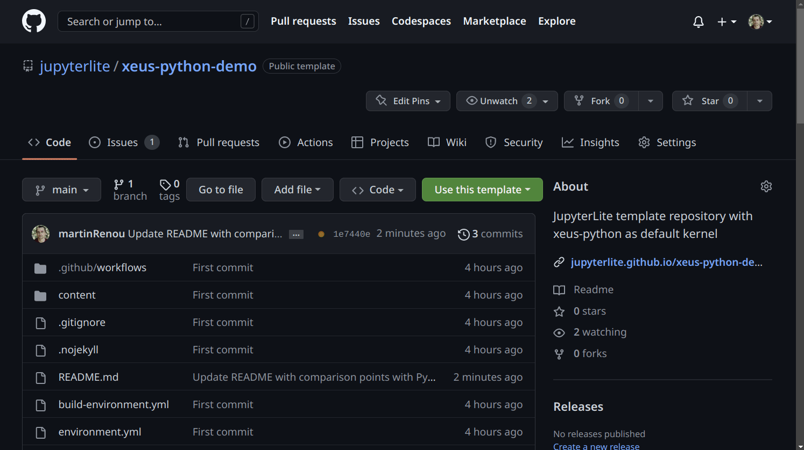

# R for Biologists: From Zero to Data Analysis

**Welcome!** This course is designed for **biologists with no programming experience**.

We learn R by solving real biological problems. Each section starts with a question a
biologist might ask, and you learn the R tools needed to answer it — step by step.

> **How to use this notebook**
> - Read the explanation in each cell
> - Run the code cells (click them and press Ctrl+Enter or Click Run)
> - When you see **▶ Your Turn**, write your own code in the cell below

---
## 1. Variables — Your Lab Notebook in Code

**The problem:** You're growing *E. coli* and measuring optical density (OD₆₀₀) every 30 minutes.
You get the values: 0.05, 0.12, 0.31, 0.78. How do you store them so you can work with them later?

**The solution:** Variables. Think of a variable as a labelled box on your bench — you put data inside, write a name on the box, and grab it whenever you need it.
In R, we use `<-` (like an arrow) to put data into a variable:
# Store the OD at time 0
od_0 <- 0.05
od_30 <- 0.12
od_60 <- 0.31
od_90 <- 0.78

# Display a variable — just type its name
od_60


# Xeus-Lite demo

[](https://jupyterlite.github.io/xeus-lite-demo/notebooks/?path=demo.ipynb)

This GitHub template allows you to create deployments of JupyterLite with a custom set of conda packages.

## 💡 How to make your own deployment

Creating a new deployment can be done in three easy steps:

**Step 1: Apply the GitHub template**

1. Click the **"Use this template"** button in the upper right corner of the GitHub repository.
2. Choose a name for your project and select the GitHub organization where you want to create it.
3. Then hit **"Create repository from template"** to finalize the setup.

**Step 2: Enable building the GitHub pages from GitHub actions.**

1. Once your repository is created, enable GitHub Pages by configuring GitHub Actions. This will build and deploy your site automatically.
2. Your deployment will be accessible at the following URL: https://{USERNAME}.github.io/{DEMO_REPO_NAME}.

**Step 3: Customize your conda environment**

1. Update your ``environment.yml`` file to include the required packages.
2. This ensures that your environment has all the necessary dependencies.

## 🎬 Visual Guide

For a step-by-step visual guide, check out the screencast below:



## 📦 How to install kernels and packages

You can install specific kernels and extra packages by adding them to the ``environment.yml`` file.

See https://jupyterlite-xeus.readthedocs.io/en/latest/environment.html for more documentation.

### Example 1: JupyterLite with NumPy and Matplotlib

To create a JupyterLite deployment with NumPy and Matplotlib pre-installed, edit the ``environment.yml`` file as follows:

```yml
name: xeus-kernel
channels:
  - https://repo.prefix.dev/emscripten-forge-dev
  - https://repo.prefix.dev/conda-forge
dependencies:
  - xeus-python
  - numpy
  - matplotlib
```

### Example 2: JupyterLite with R and coursekata

To use the R kernel and the coursekata package, edit the environment.yml file as follows:

```yml
name: xeus-kernel
channels:
  - https://repo.prefix.dev/emscripten-forge-dev
  - https://repo.prefix.dev/conda-forge
dependencies:
  - xeus-r
  - r-coursekata
```

### Example 3: JupyterLite with C++

To use the C++ kernel, edit the environment.yml file as follows:

```yml
name: xeus-kernel
channels:
  - https://repo.prefix.dev/emscripten-forge-dev
  - https://repo.prefix.dev/conda-forge
dependencies:
  - xeus-cpp
```

## 📦 How to install other jupyterlite plugins

If you want to install jupyterlite plugins, e.g. `jupyterlite-terminal`, add those plugins to the `.github/build-environment.yml` file.
